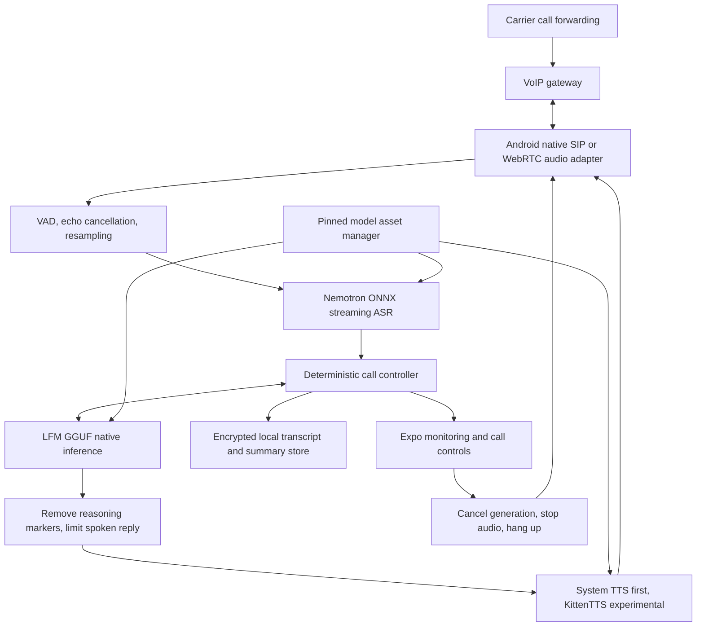

# LocalVoice implementation plan

## Current PC direction

The owner now wants all AI on the PC, with the Android app providing controls and monitoring. [PC_RUNTIME.md](PC_RUNTIME.md) is the current architecture, runbook and remaining implementation plan. The stages below describe the earlier phone-native/VoIP direction and remain background context, not evidence that SIM calling works.

PC mode is implemented as the default: authenticated localhost service, PC-only model downloads/loading, LFM generation, finite-WAV Nemotron transcription, KittenTTS synthesis and Windows speaker preview. The Models screen reports PC readiness separately from emulator HFP/SCO status. Physical SIM call audio, live conversational audio and AI summaries remain pending validation/integration.

## Outcome

An Expo React Native Android app that answers VoIP calls with local English/Hindi models, lets its owner monitor and stop conversations, and provides searchable summaries. Customization lets the owner try preferred themes, voice settings and operating profiles. Samsung Note10 5G ARM64 is the initial device.

## Current delivery

The remaining sections record the earlier mobile milestone. Statements about missing inference or absent workstation weights below apply to that historical milestone, not the current PC runtime. Current evidence and acceptance gates are in PC_VALIDATION.md and PC_RUNTIME.md.

The project began empty. This first milestone provides Expo SDK 57 / React Native 0.86 / React 19, Expo Router, a teal dashboard, light/dark/system themes, customizable settings, labeled demo conversations, searchable history, persisted transcripts, transcript-based recaps, and stop controls. The model manager downloads real pinned asset bundles on native Android, checks sizes, tracks progress, supports pause/resume and Wi-Fi policy, and offers opt-in automatic foreground downloads. Native download behavior has not been device-tested. No model weights were downloaded to this workstation.

**Native loading update:** LFM loading through llama.rn, native streaming SHA-256 verification, warm-up inference, an isolated prompt test, unload, opt-in automatic LFM loading, load-time and app PSS reporting are implemented. Nemotron ONNX sessions can be initialized separately; that does not provide transcription yet. KittenTTS's Android decoder remains unsupported. Development APK required; Expo Go only downloads assets.

**Not implemented yet:** ASR audio/decoding pipeline, KittenTTS inference, microphone conversation, real calls, AI call summaries, thermal/battery instrumentation, background downloads and encrypted production history. Demo responses remain scripted; instructions apply to the separate LFM test.

## Architecture

Expo handles screens, preferences, routing and owner controls. Audio, streaming inference, hashing large files, telemetry and background operation belong in Android native modules built through an Expo development build. Model assets remain separate from runtime capability.

## Stage 1 — App and model setup

Delivered foundation:
- Overview: controller state, history count, network, model status and recent calls.
- Calls: active demo, caller-message input, transcript, completion, immediate owner stop, history search and outcome filters.
- Models: sizes, pinned revisions, progress, download/pause/resume/retry, asset removal, missing/error states.
- Settings: light/dark/device theme; English/Hindi; simple/detailed monitoring; spoken demo responses; instructions; auto-download; Wi-Fi-only; experimental TTS; presets and reset.
- Each call captures its settings so later changes do not rewrite its history.
- History and settings persist locally. Interrupted demo calls are recovered as stopped after restart.

Next hardening: streaming native SHA-256 checks against the manifest, validated metadata for small config files, corrupted-file repair, download cancellation and persistent job checkpoints, storage budgeting based on remaining bytes, connection retries with bounded backoff. Keep partial files distinct from completed files. Use Android WorkManager/foreground notification only if background downloads are required; current downloads intentionally pause when app leaves foreground. A process killed without a saved pause snapshot may restart the current partial file; earlier completed files are reused.

Acceptance on phone: download a small test fixture first, lose Wi-Fi, resume after restart, switch to cellular with Wi-Fi-only enabled, simulate disk shortage, reject truncated files, remove/re-download a bundle, and prove auto mode never starts experimental assets without opt-in. Native inference must refuse unchecked or incompatible bundles.

## Stage 2 — Native microphone benchmark

1. Build an Android development client; confirm ARM64 and installed offline English/Hindi system voices.
2. Add a native audio module: 16 kHz mono PCM capture, VAD, streaming buffers, echo control and cancellation tokens. Use microphone first, without phone routing.
3. Port/run the Nemotron ONNX pipeline, including external weight files, tokenizer, cache management and language prompts. Validate the community export against the official model. Do not assume browser/desktop execution proves Android compatibility.
4. Add llama.cpp through an Expo native module, load LFM Q4_K_M, start with a short 2K–4K context, constrain generated reply length, preserve system instructions and strip reasoning output before speech.
5. Start with Android TTS, cached greetings and short sentences. KittenTTS C++ plus decoder is a separate experiment, with an explicit fallback if unavailable, too slow or memory-heavy.
6. Coordinate listening/transcribing/thinking/speaking/interrupted/error states. Barge-in cancels generation and playback; the stop button cancels the entire session. Do not run multiple calls simultaneously on this device initially.

Measure rather than assume: first interim/final ASR delay, first LLM token, tokens/sec, first generated audio, total response delay, peak resident memory, dropped audio buffers, temperature, battery change and CPU time. Record stage timestamps with a monotonic clock. Summarize p50/p95 only after enough samples; show sample counts. ASR correctness requires reference transcripts, not model self-scoring.

Suggested initial targets (aspirational, **not measured performance**): cached greeting starts within 500 ms; p95 conversational response under 3 seconds if the phone can sustain it; no out-of-memory termination in a 20-minute session; stop audible playback within 250 ms; no unintended restart after stop. If targets fail, shorten responses/context, reduce parallel execution, adjust ASR chunking, or retain system TTS. Change model choices only with benchmark evidence.

Acceptance: English, Hindi and code-switching sample set; noisy speech; silence; interruptions; rapid stop/restart; repeated calls; screen off; thermal throttling. Report actual phone measurements alongside the exact settings/model revisions.

## Stage 3 — Call intelligence and history

Replace scripted demo responses with native model output. Generate a structured post-call result: caller intent, concise summary, requested follow-up, unresolved questions, outcome and language. Distinguish caller requests from actions actually performed. Validate output against a schema, retain transcript-based recap if generation fails, and show summary status/errors.

Persist call events incrementally in SQLite instead of rewriting the entire prototype history blob. Add timeline search, date/language/outcome filters, summary regeneration, export and owner-approved deletion. Encrypt stored caller data with a key protected by Android Keystore; default to no audio recordings. Add configurable retention and storage usage. Summaries should never claim that a reminder, booking or message was sent unless a real tool recorded success.

Acceptance: summaries remain grounded in transcripts, incomplete calls are marked incomplete, stale events cannot reopen stopped calls, transcript remains intact after crash, deletion respects retention and export behaves offline.

## Stage 4 — Real VoIP calling

Choose gateway/provider and obtain the owner's phone-forwarding configuration and credentials. These are required deployment inputs, not invented application endpoints. Pick SIP or WebRTC based on that gateway's supported audio transport. Add secure credential storage, registration and foreground call service, incoming-call notification, Bluetooth/speaker/headset routing and reconnect handling.

Production call states: idle → ringing → connecting → listening ↔ processing/speaking → ending → ended, with explicit failed/missed branches. Every event carries call ID and generation ID; ignore stale callbacks. Display ringing/active/missed/failed/stopped outcomes. End-call action cancels ASR/LLM/TTS, drains/clears audio, hangs up the native session, waits for transport acknowledgment (or timeout with visible error), then commits the final outcome. Remote hangup follows the same cleanup path.

Use carrier forwarding to deliver SIM calls to the gateway. Stock Android does not provide unrestricted SIM audio capture and injection. A gateway needs a phone number, forwarding support, and possibly ongoing service fees. Native telephony/gateway setup cannot be completed from the UI scaffold alone.

Acceptance: incoming call, remote hangup, owner hangup from every route, failed registration, airplane mode/network switch, missed call, duplicate callbacks, Bluetooth change, interrupted app and background execution. Tell the caller they are talking to an AI assistant. Any third-party transmission or tool action requires explicit configured scope.

## Stage 5 — Monitoring and customization that compares results

Replace unavailable metrics with native telemetry. Add per-call stage timing charts, error events, network/audio dropouts, current model revisions, memory pressure and thermal state. Use thresholds from device baselines, with actionable recovery. Do not fabricate quality scores.

Extend presets into named, editable profiles: ASR chunk size, language detection vs fixed language, LFM context/reply length/temperature/threads, system voice/rate, silence timeout, interruption sensitivity and summary detail. Save the profile snapshot with each call. Offer a comparison view showing latency, memory, interruption behavior and owner-rated Hindi/English quality on the same benchmark scripts. Mark unmeasured values and sample-size differences. Keep advanced tuning on an optional page so the everyday interface stays usable.

Additional UX: onboarding checklist, permissions explanation/retry, downloadable-language check, storage warnings, model compatibility detail, agent greeting preview, notification status, call tags/favorites, retention controls and export. Allow auto-answer only after real call handling is validated and the owner enables it.

Acceptance: theme and large-font screenshots on actual phone, TalkBack navigation, 48 dp controls, system Back, keyboard behavior, color-independent error labels, one-handed stop access and profile persistence after restart.

## Stage 6 — Release readiness

Resolve dependency advisories without force-downgrading Expo/React Native. The initial npm audit reported high/moderate transitive findings; its suggested force changes include incompatible major downgrades. Maintain an audit artifact, update compatible patches, and check Android builds again. Validate licenses and attribution against each pinned model's license. KittenTTS weights use a different license from its Python package; the community ASR export also needs upstream attribution review.

Add meaningful integration tests for downloads and native cancellation, build reproducibility, crash recovery and gateway cleanup. Sign an internal APK, run the benchmark suite on the Note10, then complete a 20-minute soak and repeated-call session. Only then produce a production build. Phone performance, carrier support and native decoder portability are the critical feasibility gates; no delivery date is assumed until measured.

## Model manifest and sources

Current pinned **download sizes**, not runtime RAM: Nemotron bundle 0.74 GiB (13 files), LFM 1.56 GiB (one GGUF), experimental KittenTTS C++ bundle 1.26 GiB (four files). All three use about 3.56 GiB on disk plus partial-download headroom. The C++ KittenTTS bundle includes its decoder and differs from the smaller Python embedding-quantized option in the pasted brief. Runtime memory must be measured separately.

The manifest in `src/data/models.json` contains revision, URL, exact byte size and published SHA-256 where present. `node scripts/pin-models.mjs` refreshes metadata intentionally; it does not download weights. Never silently refresh revisions in production.

- [Expo development builds](https://docs.expo.dev/develop/development-builds/introduction/)
- [Expo SDK 57 file downloads](https://docs.expo.dev/versions/v57.0.0/sdk/filesystem-legacy/)
- [NVIDIA model](https://huggingface.co/nvidia/nemotron-3.5-asr-streaming-0.6b)
- [Nemotron community ONNX INT4 export](https://huggingface.co/onnx-community/nemotron-3.5-asr-streaming-0.6b-onnx-int4)
- [LiquidAI GGUF release](https://huggingface.co/LiquidAI/LFM2.5-2.6B-GGUF)
- [KittenTTS weights and CPU bundle](https://huggingface.co/KittenML/kitten-tts-2)
- [KittenTTS C++ backend](https://github.com/KittenML/kitten-tts-2-cpp)

Voice preference update: persistent system/KittenTTS selection is available in Settings, with explicit active-engine status and system speech fallback. KittenTTS synthesis still requires the Android decoder port.

Incoming policy implemented for demos: manual approval by default, opt-in unanswered timeout with owner cancellation, policy snapshot per ringing event, foreground cancellation. Android microphone/notification request controls and native manifest permissions added. Rebuild APK for permission changes; VoIP/audio/background notifications still pending.
